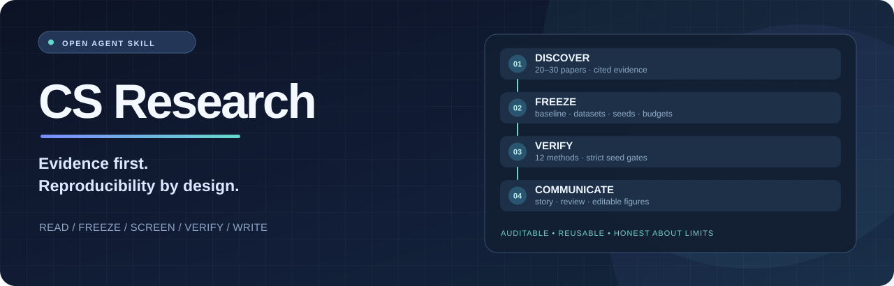
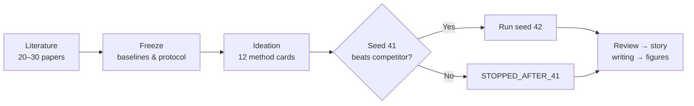

<p align="center">
  
</p>

<p align="center">
  <a href="https://github.com/ChenXiangYpily1234/CS-reasearch/actions/workflows/tests.yaml"></a>
  <a href="skills/cs-research/SKILL.md"></a>
  <a href="README.en.md"></a>
</p>

<p align="center">
  <strong>An evidence-driven research workflow for AI/ML agents.</strong><br>
  把「读论文 → 冻结实验 → 设计方法 → 筛选验证 → 写论文 → 科研作图」变成可追踪、可复核的工作流。
</p>

<p align="center">
  <a href="#quick-start">快速开始</a> ·
  <a href="#workflow">研究流程</a> ·
  <a href="#what-you-get">模板与工具</a> ·
  <a href="README.en.md">English</a> ·
  <a href="CONTRIBUTING.md">参与贡献</a>
</p>

---

## Why CS Research?

很多科研 Agent 能给出建议，却不一定能说明：**文献是否真实、实验条件是否一致、结果来自哪里、什么还没做。**

```text
Research idea → Evidence → Frozen protocol → Candidate screening → Paper story → Figures
```

CS Research 是一个**可安装的 Agent Skill + 研究协议模板包**，重点在于：

| 核心设计 | 它帮助你解决什么 |
| --- | --- |
| **Evidence first** | 要求核验 20–30 篇相关论文，并区分事实、推断和假设 |
| **Freeze before experiments** | 固定基线、竞争方法、数据、指标、预算和种子，减少事后调整 |
| **12 distinct directions** | 用方法卡与差异矩阵比较 12 个研究方向，而不是反复改同一模块 |
| **Explicit seed gate** | seed 41 严格超过对照才进入 seed 42；记录停止和阻塞状态 |
| **Paper-ready handoff** | 串联论文故事、写作、独立审核与可编辑科研图的职责与证据 |

**适用对象：** 希望用 Codex、Claude Code 等支持 Agent Skills 的工具组织 AI/ML 科研计划、实验记录和论文产物的研究者。它不是自动化 GPU 训练平台，也不保证论文录用。

## Quick start

### 1 · 安装 Skill

在具备 Node.js 和兼容 Agent 工具的环境中运行：

```bash
npx skills add ChenXiangYpily1234/CS-reasearch --skill cs-research
```

安装器会让你选择受支持的 Agent；具体选项以 [skills CLI 文档](https://github.com/vercel-labs/skills/blob/main/docs/commands.md)为准。也可手动复制完整的 [`skills/cs-research`](skills/cs-research) 目录到 Agent 的 Skill 路径（含 `references`、`config`、`templates`、`prompts`、`scripts`）。

### 2 · 复制这段话到研究 Agent

```text
请使用 $cs-research。
研究方向：高效文本分类（示例，请替换为你的课题）
GPU / 服务器：暂未提供
请先核对缺少的输入、生成待冻结协议清单，列出每阶段的证据与状态。
不要假定已经检索文献、运行实验或取得任何性能提升。
```

**没有 GPU 也可以先体验规划与审查。** 查看 [零 GPU 首次运行示例](examples/first-run.md)，了解合理输出应是什么样，而不是把模板当作真实结果。

### 3 · 开始自己的课题

从 [课题输入模板](skills/cs-research/templates/project.md) 开始，随后参照 [完整科研工作流](skills/cs-research/references/workflow.md) 逐阶段推进。继续已有课题时应读取原有冻结协议及结果账本，不覆盖历史结果。

## Workflow



这是**流程示意**，不是已完成研究的结果。最终确认还包括独立的 seed 43、消融与泛化方案；详细边界请阅读 [workflow.md](skills/cs-research/references/workflow.md)。

## What you get

| 入口 | 用途 |
| --- | --- |
| [`SKILL.md`](skills/cs-research/SKILL.md) | Agent 可发现的工作流入口、阶段路由和执行约束 |
| [`workflow.yaml`](skills/cs-research/config/workflow.yaml) | 可复制并填写的默认冻结协议（未填写项保留 `null`） |
| [课题输入](skills/cs-research/templates/project.md) / [文献表](skills/cs-research/templates/literature.md) | 定义问题、来源与证据 |
| [实验冻结表](skills/cs-research/templates/experiment-freeze.md) / [方法卡](skills/cs-research/templates/method-card.md) | 保持实验公平、方法可证伪 |
| [seed gate 脚本](skills/cs-research/scripts/check_seed_gate.py) | 根据给定原始数值计算是否可进入 seed 42 |
| [科研图 brief](skills/cs-research/templates/figure-brief.md) | 检查图形语义、可编辑性与视觉质量 |
| [测试记录](tests/VALIDATION.md) | 查看已做过的本地验证及其证据范围 |

一个**可直接运行、无需 GPU** 的小检查：

```bash
python3 skills/cs-research/scripts/check_seed_gate.py \
  --candidate 0.8001 --competitor 0.8000 --direction maximize
```

期望输出（仅根据输入数值计算，不验证实验来源）：

```json
{"eligible_seed_42": true, "decision": "ELIGIBLE"}
```

## Scope & honesty

- **已提供：** Skill 目录、阶段协议、项目模板、seed 门槛脚本、单元测试与 CI 工作流。
- **尚未提供：** 特定课题的 20–30 篇已核验文献、GPU 实验、实际模型监督记录、论文审稿结果或已生成的可编辑 PPT。
- 默认状态为 `NOT_RUN`。`BLOCKED`、`STOPPED_AFTER_41`、`COMPLETE` 必须按真实证据使用，不能用示例输出代替研究结果。
- 文稿、审稿、作图的部分阶段引用**外部 Skills**；这些依赖不会被本仓库自动安装。查看 [依赖来源与职责](skills/cs-research/references/workflow.md#skills-与来源)。

项目的价值是**帮助研究者组织和核验工作**，不是代替科研判断，更不是自动制造结果。

## Contribute

欢迎提交文档修正、失效链接、可复现 bug 报告、真正有用的模板与测试。请先阅读 [CONTRIBUTING.md](CONTRIBUTING.md)。

如果你觉得这种 **evidence-first** 的研究流程有参考价值，可以为仓库点一个 **Star**，也欢迎分享你实际使用时遇到的限制与改进建议。

[English guide](README.en.md) · [First-run walkthrough](examples/first-run.md) · [Full workflow](skills/cs-research/references/workflow.md)

